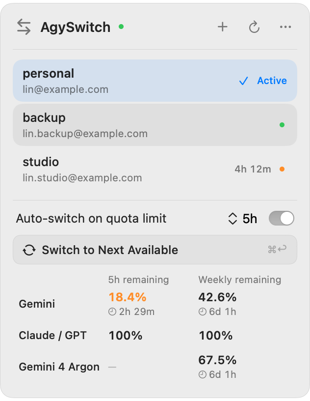
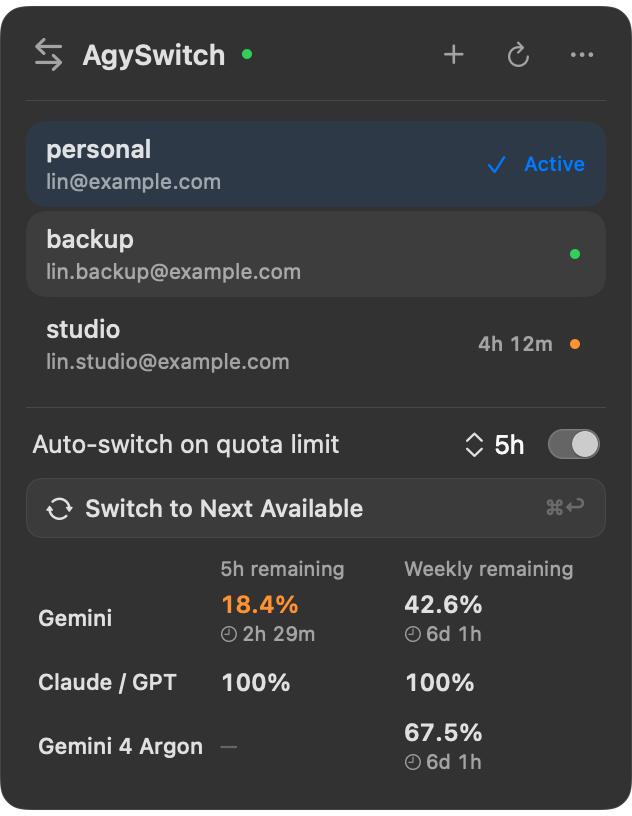
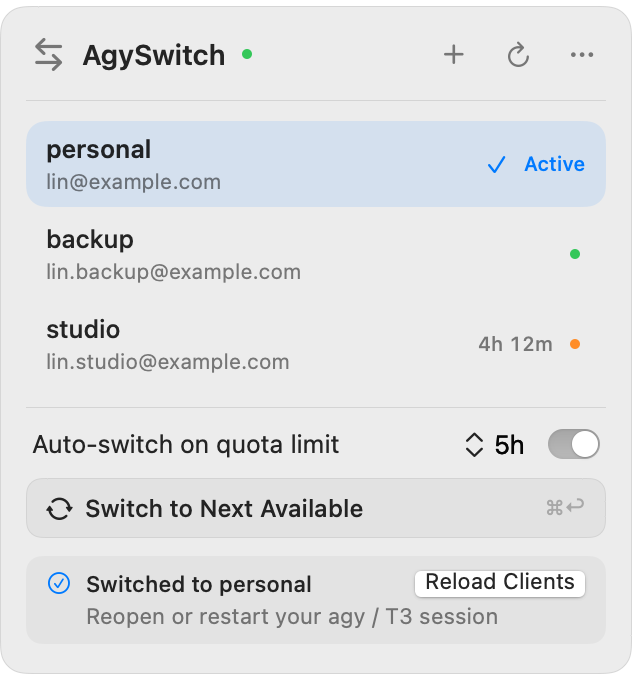
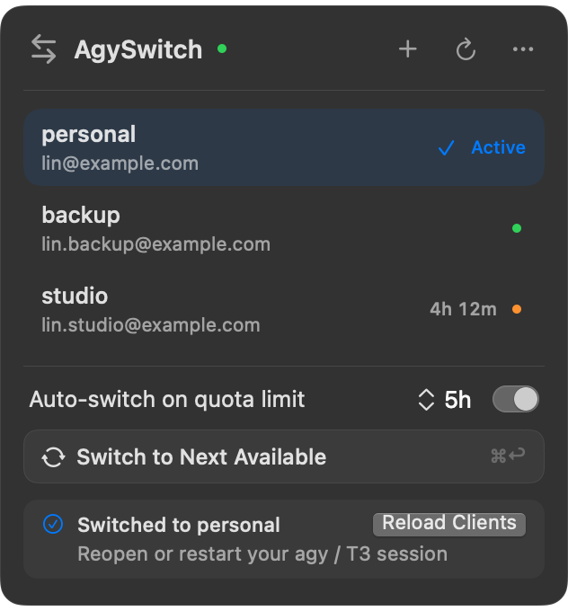

# AgySwitch

English | [简体中文](README.zh-CN.md)

> **AgySwitch** (`v0.2.2`) is an ultra-lightweight (**~2.5 MB**), native macOS menu bar app built with pure Swift & SwiftUI for switching multiple **Google Antigravity CLI (`agy`)** accounts via lossless macOS Keychain snapshots—featuring **on-demand hover quota inspection** (**Gemini 5h/weekly**, **Claude/GPT 5h/weekly**, and **Gemini 4 Argon weekly**), **one-click tri-client reload** (`Antigravity.app` + T3 Code `agy acp` + terminal `agy`), **automatic quota-exhaustion switching** via passive local log monitoring, **zero third-party dependencies**, **no proxy or OAuth gateway**, and a **built-in English & Simplified Chinese UI** (system-following or instant in-menu switch).

**AgySwitch** sits quietly in your macOS menu bar (`⇄`) and makes multi-account `agy` workflows effortless. Whether you rotate two or three **Google AI Pro** accounts (especially during Black Friday or promotional pricing) to achieve near-**Ultra** effective quota capacity, or separate work and personal subscriptions, AgySwitch captures and switches local Keychain credentials in a single click or shortcut, previews live remaining quotas on hover, and automatically rotates to the next available account when a session hits a rate limit—without routing traffic through a proxy gateway, running background network polling, or touching your `agy` settings, MCP servers, skills, or conversation history.

---

## Download & Install (macOS 14+ · Apple Silicon `arm64`)

### Option 1: One-Line Terminal Install (Recommended · Verified & No Gatekeeper Prompt)

Downloads the latest release directly from GitHub Releases, verifies its **SHA-256** checksum against `SHA256SUMS.txt`, verifies the bundle identifier and code signature, installs to `/Applications/AgySwitch.app` without browser quarantine attributes, and launches it in your menu bar:

```bash
curl -fsSL https://raw.githubusercontent.com/wanghao-SunSky/AgySwitch/main/scripts/install.sh | bash
```

> Inspect the installer source at [`scripts/install.sh`](scripts/install.sh). To install into your user Applications folder instead, prefix with `AGYSWITCH_INSTALL_DIR="$HOME/Applications"`.

### Option 2: Let Your AI Audit & Build Locally (Zero-Trust · No Gatekeeper Prompt)

Since AgySwitch reads and writes macOS Keychain credentials and uses local ad-hoc signing, you don't have to take prebuilt binaries on faith. Copy and paste this prompt into **Claude Code, Codex, Antigravity (`agy`), or Cursor** to have your own AI agent audit every source file first, report back to you, and build `AgySwitch.app` locally from source once you approve (locally compiled builds carry no browser quarantine attributes and trigger zero Gatekeeper prompts):

```text
Clone https://github.com/wanghao-SunSky/AgySwitch.git to /tmp/AgySwitch and perform a full security audit of every file under Sources/ and scripts/ before building anything:
1. Verify network & dependency boundaries: confirm that except for Sources/AgySwitchCore/Quota.swift—which uses an ephemeral, no-cookie, no-cache, no-redirect URLSession only when on-demand hover quota inspection is enabled to send read-only requests directly to Google's official quota endpoints (https://aicode.googleapis.com/v1alpha:fetchQuotaStatus and https://daily-cloudcode-pa.googleapis.com/v1internal:retrieveUserQuotaSummary) and never communicates with any third-party server—all other application code under Sources/, scripts/build_app.sh, and scripts/generate_icon.swift makes zero network calls, runs no proxy/gateway or background polling (only scripts/install.sh downloads releases from this GitHub repo), and Package.swift has zero third-party dependencies.
2. Verify Keychain & file boundaries: confirm it only reads/writes the macOS login Keychain entries for "gemini" / "antigravity" and its local snapshot vault via `/usr/bin/security -i` stdin pipes, never writes plaintext tokens to disk (only non-sensitive alias, email, and cooldown metadata in registry.json), and never modifies agy's settings.json, MCP configs, skills, or history.
3. Verify passive log monitoring: confirm the quota watcher only tails `~/.gemini/antigravity-cli/log/cli-*.log` and `acp-server-*.log` in read-only mode.

Present a concise security audit report with file and line references and wait for my confirmation. Once I approve, run `swift test`, then run `./scripts/build_app.sh --install` to compile and install `/Applications/AgySwitch.app` from source, and launch it with `open -a /Applications/AgySwitch.app`.
```

### Option 3: Manual Download

- 📦 [**Download DMG Installer (`AgySwitch-v0.2.2-macos-arm64.dmg`)**](https://github.com/wanghao-SunSky/AgySwitch/releases/download/v0.2.2/AgySwitch-v0.2.2-macos-arm64.dmg)
- 🗂️ [**Download ZIP Archive (`AgySwitch-v0.2.2-macos-arm64.zip`)**](https://github.com/wanghao-SunSky/AgySwitch/releases/download/v0.2.2/AgySwitch-v0.2.2-macos-arm64.zip)
- 🔗 [**GitHub Releases & `SHA256SUMS.txt`**](https://github.com/wanghao-SunSky/AgySwitch/releases/latest)

**First Launch Note (Manual Browser Downloads Only)**: Because AgySwitch is distributed with local ad-hoc signing rather than a paid Apple Developer ID certificate, macOS Gatekeeper may quarantine archives downloaded via a web browser. If macOS says the app is "damaged" or "cannot be verified" after dragging it to `/Applications`, clear the browser quarantine attribute once:

```bash
xattr -cr /Applications/AgySwitch.app
```

---

## Screenshots

| Hover Quota Popover: 5h / Weekly / Gemini 4 Argon (Light) | Hover Quota Popover: 5h / Weekly / Gemini 4 Argon (Dark) |
| :---: | :---: |
|  |  |
| **Account Switch & One-Click Client Reload (Light)** | **Account Switch & One-Click Client Reload (Dark)** |
|  |  |

---

## Why AgySwitch? · Comparison

Heavy daily usage of frontier models in Google Antigravity CLI (`agy`) quickly exhausts a single account's 5-hour or weekly quota window. Many developers pair two or three **Google AI Pro** accounts (especially when promotional or Black Friday discounts make multi-Pro setups much more cost-effective than a single Ultra tier) and rotate them across coding sessions. Here is how **AgySwitch** compares to local proxy gateways and manual `/logout` rotation:

| Dimension | **AgySwitch (`v0.2.2`)** | Local Proxy / OAuth Gateway Tools | Manual `/logout` & Re-login |
| :--- | :--- | :--- | :--- |
| **Traffic Path** | **100% stock `agy` direct connection** | Routed through a local proxy / custom gateway | Stock `agy` direct connection |
| **Live Quota Visibility** | **Hover any account** for **Gemini (5h + Weekly)**, **Claude/GPT (5h + Weekly)** & **Gemini 4 Argon (Weekly)** | Custom dashboard via gateway polling | None (must log into each account to check) |
| **Network Activity** | **Zero background polling** (on-demand read-only official quota query on hover; toggleable to strict zero-network mode) | Continuous background polling & token proxying | None |
| **Switching Speed** | Instant single click or `⌘↩` in menu bar (accelerated by Keychain metadata version caching) | Automatic proxy routing | `/logout` + browser OAuth flow every time |
| **Client Reload** | One-click or automatic reload across **`Antigravity.app` + T3 Code `agy acp` + terminal `agy`** | Proxy-level hot swap | Manual app/terminal restart |
| **Auto-Switch on Quota Exhaustion** | Yes (passive local log tailing, zero network polling) | Yes (gateway error interception) | No |
| **App Footprint** | **~2.5 MB** (100% native Swift & SwiftUI) | Tens to hundreds of MB (Electron / Go / Node runtimes) | — |
| **Config Intrusiveness** | Swaps only 1 Keychain item; touches zero `agy` configs | Overrides API endpoints, proxy env, or client configs | None |
| **Interface Language** | Built-in **English & Simplified Chinese** (live switch) | Varies | — |

---

## Core Features

### 1. Live Quota Inspection on Hover (5h / Weekly / Gemini 4 Argon)
- **Instant Hover Breakdown**: Hover over any saved account row for `250ms` to inspect its real-time remaining quota percentages and reset countdowns across:
  - **Gemini** (`5h` + `Weekly` windows)
  - **Claude / GPT** (`5h` + `Weekly` windows)
  - **Gemini 4 Argon** (`Weekly` window)
- **On-Demand, Ephemeral & Zero Background Polling**: Quota queries run strictly on demand when you hover an account row, using a 5-minute in-memory cache (`QuotaCache`). Click `↻` in the top bar anytime to invalidate the cache and force a fresh read.
- **One-Click Strict Zero-Network Mode**: Prefer zero outbound requests of any kind? Toggle off **Show Quota on Hover** in the top-right `⋯` menu to cancel any in-flight quota requests, clear the quota cache, and run AgySwitch in strict offline/local-only mode.

### 2. Zero-Friction Account Capture, Fast Switching & Tri-Client Reload
- **One-Click Add Account (`+`)**: Click `+` in the top bar to safely back up your current login, clear the active login slot, and launch `agy` in a sized macOS Terminal window (`38×108`) for official browser OAuth sign-in. Once signed in, AgySwitch detects the new account automatically and surfaces a top **Save** capsule.
- **Accelerated Single-Click & Shortcut Switching**: Click any account row to switch immediately, or press **`⌘↩`** to jump straight to the next available (non-cooling) account. `v0.2.2` introduces **Keychain metadata version caching**, avoiding redundant payload parses and making account switches and status refreshes noticeably snappier.
- **Reliable Tri-Client Reload (Desktop + T3 Backend + CLI)**: Click **Reload Clients** on the post-switch banner (or enable **Auto-Reload Clients on Switch** in `⋯`) to:
  - Gracefully restart a running **`Antigravity.app`** with sanitized Electron/Node environment variables so it never fails to relaunch;
  - Recycle **`agy acp`** backend servers seamlessly without closing your open **T3 Code** windows;
  - Terminate stale terminal **`agy`** processes and **automatically verify the active Keychain credential after reload** so exiting processes cannot overwrite your newly switched account.
- **Cooldown & Account Management**: Right-click any account row to mark a cooldown (`5h` / `3h` / `1h`), clear an active cooldown, rename its alias, or remove the snapshot.

### 3. Automatic Quota-Exhaustion Switching (Passive Local Log Monitoring)
- When **Auto-switch on quota limit** is enabled, AgySwitch passively tails newly appended lines in `~/.gemini/antigravity-cli/log/cli-*.log` and `acp-server-*.log` (covering both terminal `agy` and T3 Code sessions)—**performing zero network polling**.
- Detects Google's quota markers (`RESOURCE_EXHAUSTED`, `QUOTA_EXHAUSTED`, `STOP_REASON_QUOTA_EXHAUSTED`, `Individual quota reached`) and, on agy's error- and warning-level lines, generic `429` / quota wording:
  - **False-Positive Filtering**: Filters out glog thread IDs containing `429`, non-error configuration lines, MCP and tool output, background polls (including their multi-line JSON error bodies), and requests agy is still retrying. `MODEL_CAPACITY_EXHAUSTED` (a server-side shortage, not your quota) never triggers a switch.
  - **Per-Account Attribution & Log Retirement**: Each log is matched to the account its agy process signed in with (`applyAuthResult: email=…`), so a session running on another account, or through a gateway, can't switch the active one. A log without a sign-in line is attributed to the account that was active when it appeared, and isn't trusted for 30 seconds after a switch. Logs from sessions started before a switch are retired; an exhaustion in a session started after the switch is handled right away.
  - **Smart Cooldown Duration**: Uses agy's own reset time (`Resets in 4h58m54s`, a reset timestamp, or `retryDelay`); otherwise falls back to your selected default cooldown (`5h` / `3h` / `1h`). After a failed switch (for example, every other account cooling down) it waits 30 seconds, then retries with the latest error from each account that arrived meanwhile.
  - **Native Notification**: Automatically activates the next available account and posts a macOS system notification.

### 4. Ultra-Lightweight Native macOS Menu Bar App
- Built with **100% pure Swift, SwiftUI, and AppKit** with **zero third-party dependencies**.
- The entire `AgySwitch.app` bundle is only **~2.5 MB** (**~1.6 MB** main executable), runs strictly as a menu bar agent (`LSUIElement`, no Dock icon clutter), features unified native hover feedback across top-bar controls, adapts automatically to macOS Light and Dark appearances, and supports one-click **Launch at Login**.
- **Built-in Bilingual UI (English & 简体中文)**: Automatically follows your macOS system language by default, or lets you switch between English and Simplified Chinese instantly from the top-right `⋯` menu without restarting.

---

## Security & Architecture

AgySwitch touches only the single macOS Keychain item responsible for `agy` authentication and **never modifies** `agy`'s `settings.json`, conversation history, MCP servers, or skills:

1. **Lossless Keychain Snapshot & Restore**: Reads and writes only the `gemini / antigravity` generic password entry in your login Keychain, preserving the exact `go-keyring-base64:` prefix and raw payload byte-for-byte.
2. **Encrypted Credential Vault Isolated from Metadata**:
   - Full credential snapshots are stored inside your macOS login Keychain under a dedicated vault service namespace.
   - Local metadata in `registry.json` (directory `0700`, file `0600`, guarded by exclusive `flock` file locks) stores only account aliases, display emails, and cooldown timestamps—**never plaintext tokens**.
3. **Stdin Pipe Execution (`security -i`)**: Sensitive Keychain write commands are piped through standard input to `/usr/bin/security -i` so credentials never appear in process command-line arguments (`ps`).
4. **Silent Token-Refresh Write-Back**: Before switching away from the currently active account, AgySwitch automatically syncs the live Keychain payload back to its vault snapshot so silent background OAuth token refreshes performed by `agy` are never lost.
5. **Byte-for-Byte Read-Back & Post-Reload Verification**: Every switch immediately reads back the written Keychain entry and verifies it byte-for-byte against the target snapshot—and re-verifies after client reloads so terminating `agy` processes cannot revert the active credential.
6. **Ephemeral Read-Only Quota Requests (Toggleable to Strict Zero-Network)**:
   - Implemented in [`Sources/AgySwitchCore/Quota.swift`](Sources/AgySwitchCore/Quota.swift) using `URLSessionConfiguration.ephemeral` with cookies, caches, credential storage, and HTTP redirects (`NoRedirect`) completely disabled.
   - Triggered only on user hover (`250ms` debounce) to query Google's official read-only quota endpoints (`https://aicode.googleapis.com/v1alpha:fetchQuotaStatus` and `https://daily-cloudcode-pa.googleapis.com/v1internal:retrieveUserQuotaSummary`) using the snapshot's existing Bearer token.
   - Never proxies conversation traffic, never polls in the background, never contacts third-party servers, and can be completely disabled via **Show Quota on Hover** in `⋯`.

---

## Frequently Asked Questions (FAQ)

**Q: Why does a running `agy` session or desktop app still use the old account right after I switch?**  
`agy`, `Antigravity.app`, and T3 Code's `agy acp` backend read the macOS Keychain credential into memory when a session starts. After switching accounts in AgySwitch, simply click **Reload Clients** on the prompt banner (or enable **Auto-Reload Clients on Switch** in the `⋯` menu) to automatically restart `Antigravity.app`, recycle T3 Code's `agy acp` backend without closing your windows, and stop stale terminal `agy` processes.

**Q: How do I add multiple Google Antigravity CLI accounts?**  
Click the `+` button in the AgySwitch top bar. AgySwitch will automatically back up your current account, clear the active login slot, and open a Terminal window running `agy` for official browser OAuth sign-in. Once signed in, click **Save** in AgySwitch. You can also log in manually via `agy` in your terminal and click **Save** when AgySwitch detects the unsaved login.

**Q: Does AgySwitch route traffic through a proxy or make background network calls?**  
AgySwitch runs **no local proxy, no OAuth gateway, and zero background polling**. Every `agy` conversation and tool call goes 100% directly from the official `agy` binary to Google. The only network code in the entire repository ([`Sources/AgySwitchCore/Quota.swift`](Sources/AgySwitchCore/Quota.swift)) is an on-demand, read-only request to Google's official quota endpoints (`aicode.googleapis.com` and `daily-cloudcode-pa.googleapis.com`) using an ephemeral, no-cookie, no-redirect `URLSession` when you hover over an account row—and you can turn off **Show Quota on Hover** in `⋯` anytime for strict zero-network operation.

**Q: Does AgySwitch support Intel Macs, Windows, or Linux?**  
AgySwitch is built specifically for macOS Keychain and currently targets **macOS 14.0+ on Apple Silicon (`arm64`)**.

---

## Build from Source

Requirements: macOS 14.0+ (Apple Silicon `arm64`), Xcode / Swift 5.9+.

```bash
# Build, bundle, ad-hoc sign, and install to /Applications/AgySwitch.app
./scripts/build_app.sh --install

# Run unit tests
swift test
```

---

## License

Released under the [MIT License](LICENSE).
