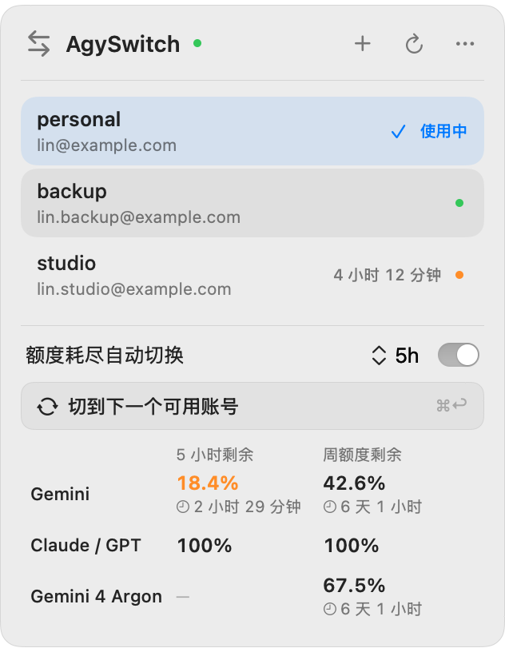
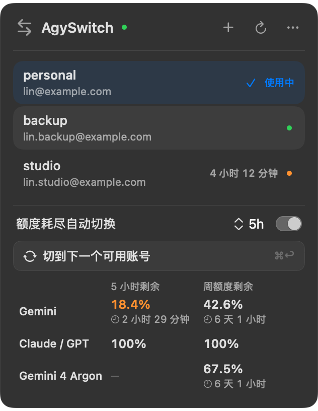
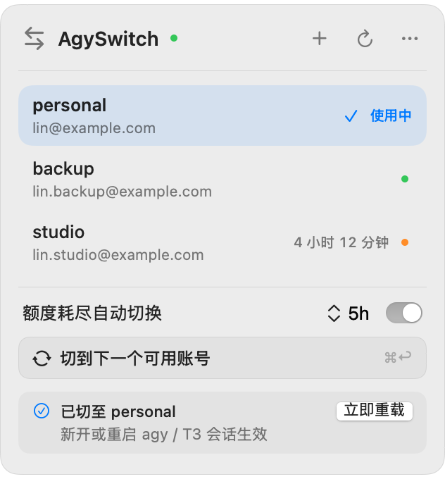
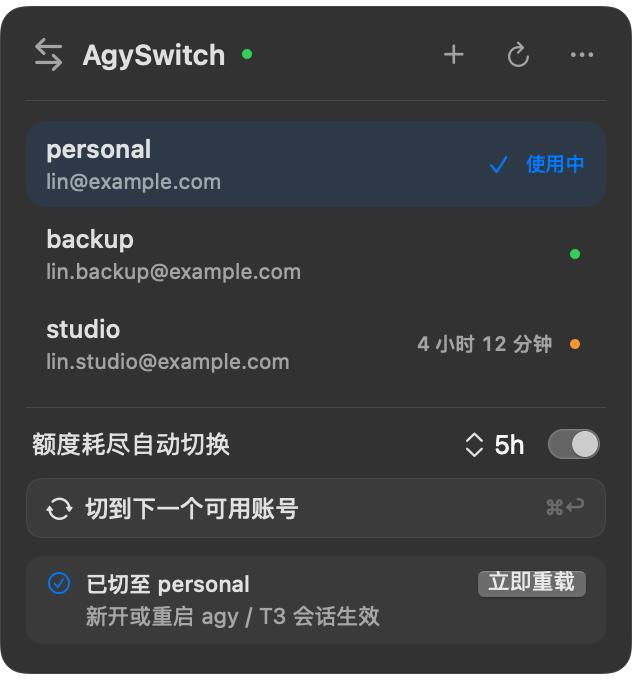

# AgySwitch

[English](README.md) | 简体中文

> **AgySwitch**（`v0.2.2`）是一款专为 **Google Antigravity CLI（`agy`）** 打造的超轻量（**~2.5 MB**）**macOS 原生菜单栏多账号切换与额度查看工具**——100% 纯 Swift & SwiftUI 构建，**零第三方依赖**、**不做本地反代或 OAuth 网关**，基于 macOS Keychain 无损快照秒切账号，支持**鼠标悬停实时查看各账号剩余额度（Gemini 5h/周额度、Claude/GPT 5h/周额度、Gemini 4 Argon 周额度）**、**三端一键联动重载（Antigravity 桌面版 + T3 Code `agy acp` 后端 + 终端 `agy`）**、**纯本地被动日志监听的额度耗尽自动切号**，并内置**简体中文与英文双语界面**（默认跟随系统或菜单内实时切换）。

**AgySwitch** 常驻 macOS 顶部菜单栏（`⇄`），专为高频使用 `agy` 的开发者设计。无论是趁黑五或优惠活动备两三个 **Google AI Pro** 账号轮换使用、以更低成本用出接近 **Ultra** 的高阶模型额度体验，还是在工作号与个人号之间无缝切换，AgySwitch 都能做到单击或快捷键秒切、悬停即看真实剩余配额、额度见底自动轮换——全程不代理任何对话流量、不做后台网络轮询，也不修改 `agy` 的任何业务配置、MCP、Skills 或对话历史。

---

## 下载安装（macOS 14+ · Apple Silicon `arm64`）

### 方式一：终端一键安装（推荐 · 自动校验 SHA-256 · 免 Gatekeeper 弹窗）

通过 `curl` 直接从 GitHub Releases 下载最新安装包，自动比对 `SHA256SUMS.txt` 校验值并核验签名后安装到 `/Applications/AgySwitch.app`，不触发浏览器下载隔离标记，装完自动在顶部菜单栏启动：

```bash
curl -fsSL https://raw.githubusercontent.com/wanghao-SunSky/AgySwitch/main/scripts/install.sh | bash
```

> 可查看完整安装脚本源码：[`scripts/install.sh`](scripts/install.sh)。如需安装到当前用户目录，可在命令前加 `AGYSWITCH_INSTALL_DIR="$HOME/Applications"`。

### 方式二：让你的 AI 先审源码再本机编译安装（零信任 · 免 Gatekeeper 弹窗）

由于 AgySwitch 涉及 macOS Keychain 凭证读写且采用本地 ad-hoc 签名，如果你不想盲信陌生仓库或预编译包、也懒得自己逐行审代码，可以直接复制下方 Prompt 发给 **Claude Code、Codex、Antigravity（`agy`）或 Cursor**，让你的 AI 先逐文件完成安全审计并向你汇报结论，确认无虞后再从本机源码编译安装（本机编译天生无浏览器 quarantine 标记，完全不触发 Gatekeeper 拦截）：

```text
请先把 https://github.com/wanghao-SunSky/AgySwitch.git 克隆到 /tmp/AgySwitch，在执行任何编译或安装前，逐文件审计 Sources/ 和 scripts/ 下的全部代码：
1. 核实网络与依赖边界：确认除 Sources/AgySwitchCore/Quota.swift 在开启「悬停查看剩余额度」且用户鼠标悬停账号行时，使用无 Cookie、无缓存、禁止重定向的 ephemeral URLSession 仅向 Google 官方只读配额端点（https://aicode.googleapis.com/v1alpha:fetchQuotaStatus 与 https://daily-cloudcode-pa.googleapis.com/v1internal:retrieveUserQuotaSummary）发起只读查询、且绝不向任何第三方服务器发请求外，其余 Sources/ 应用源码以及 scripts/build_app.sh、scripts/generate_icon.swift 零网络调用、零反代/网关、零后台轮询（仅 scripts/install.sh 用于从本仓库 Releases 下载安装包），且 Package.swift 零第三方依赖。
2. 核实 Keychain 与文件边界：确认只读写 macOS login Keychain 中的 `gemini / antigravity` 与本地快照库条目，敏感写入均通过 `/usr/bin/security -i` 标准输入管道传参，不落盘任何明文 Token（本地 `registry.json` 仅存别名、邮箱和冷却时间），且绝不修改 `agy` 的 `settings.json`、MCP、Skills 或对话历史。
3. 核实日志监听只读：确认本地额度监听器仅对 `~/.gemini/antigravity-cli/log/cli-*.log` 与 `acp-server-*.log` 做只读监听。

请先向我输出一份简明的安全审计报告（附关键文件与行号）并等待我确认；待我确认安全后，再运行 `swift test` 验证测试通过，随后执行 `./scripts/build_app.sh --install` 从本机源码编译打包安装到 `/Applications/AgySwitch.app`，并用 `open -a /Applications/AgySwitch.app` 启动。
```

### 方式三：手动下载安装包

- 📦 [**下载 DMG 安装包（`AgySwitch-v0.2.2-macos-arm64.dmg`）**](https://github.com/wanghao-SunSky/AgySwitch/releases/download/v0.2.2/AgySwitch-v0.2.2-macos-arm64.dmg)
- 🗂️ [**下载 ZIP 压缩包（`AgySwitch-v0.2.2-macos-arm64.zip`）**](https://github.com/wanghao-SunSky/AgySwitch/releases/download/v0.2.2/AgySwitch-v0.2.2-macos-arm64.zip)
- 🔗 [**Releases 页面（含 `SHA256SUMS.txt` 校验值）**](https://github.com/wanghao-SunSky/AgySwitch/releases/latest)

**手动下载首次打开说明**：因未购买 Apple 付费开发者证书、采用本地 ad-hoc 签名，通过浏览器手动下载后拖入 `/Applications` 打开时，若 macOS 提示「已损坏」或「无法验证开发者」，运行一行命令移除浏览器隔离属性即可：

```bash
xattr -cr /Applications/AgySwitch.app
```

---

## 界面预览 · Screenshots

| 悬停实时查看 5h / 周额度 / Gemini 4 Argon（浅色） | 悬停实时查看 5h / 周额度 / Gemini 4 Argon（深色） |
| :---: | :---: |
|  |  |
| **切号提示与一键客户端重载（浅色）** | **切号提示与一键客户端重载（深色）** |
|  |  |

---

## 为什么做 AgySwitch · 方案对比

重度使用 Google Antigravity CLI（`agy`）的高阶模型时，单个账号的 5 小时或周配额窗口往往很快见底。不少开发者会趁黑五或促销活动备两三个 **Google AI Pro** 账号轮换使用，用远低于单买 Ultra 的成本获得接近 Ultra 的可用额度上限。**AgySwitch** 与常见切号方案的核心区别如下：

| 对比维度 | **AgySwitch（`v0.2.2`）** | 本地反代 / OAuth 网关类工具 | 官方手动 `/logout` 重登 |
| :--- | :--- | :--- | :--- |
| **对话流量链路** | **100% 官方原版 `agy` 直连** | 第三方网关代理转发 | 官方原版 `agy` 直连 |
| **剩余额度查看** | **鼠标悬停任意账号**即看 **Gemini（5h+周）**、**Claude/GPT（5h+周）**、**Gemini 4 Argon（周）** 剩余百分比与重置倒计时 | 网关面板轮询展示 | 不支持（需逐个登录查看） |
| **网络请求行为** | **零后台轮询**（仅悬停账号时按需直连官方只读配额接口；可在 `⋯` 一键关闭切回严格零网络模式） | 持续后台轮询 + 代理转发对话请求 | 无 |
| **切号速度** | 菜单栏单击或 `⌘↩` 秒切（内置 Keychain 元数据版本缓存提速） | 自动路由 | 每次登出 + 开浏览器重新 OAuth 授权 |
| **客户端重载** | 一键或切号自动联动重载 **`Antigravity.app` + T3 Code `agy acp` + 终端 `agy`** | 网关层热切 | 需手动重启客户端或终端 |
| **额度用光自动切号** | 支持（纯本地被动监听日志，零网络探测） | 支持（网关侧拦截报错） | 不支持 |
| **安装包体积** | **~2.5 MB**（纯原生 Swift & SwiftUI） | 几十至数百 MB（Electron / Go / Node 运行时） | — |
| **配置侵入度** | 只切 Keychain 单条登录凭证，零配置侵入 | 需接管网关/代理或客户端配置 | 无 |
| **界面语言** | 内置**简体中文 / English 双语**（实时切换） | 视工具而定 | — |

---

## 核心特性 · Core Features

### 1. 悬停实时查看剩余额度（5 小时 / 周额度 / Gemini 4 Argon）
- **鼠标悬停即看全模型配额**：将鼠标悬停在任意账号行 `250ms` 后，按需直连 Google 官方只读配额接口，清晰展示该账号的实时剩余百分比与重置倒计时：
  - **Gemini**（`5 小时` + `周额度`）
  - **Claude / GPT**（`5 小时` + `周额度`）
  - **Gemini 4 Argon**（`周额度`）
- **5 分钟内存缓存 & 零后台轮询**：仅在用户悬停时按需请求，结果在内存中缓存 5 分钟（点击顶栏 `↻` 按钮可立即清空缓存并强制刷新），绝不在后台定时轮询。
- **一键切回严格零网络模式**：对网络洁癖用户，可在右上角 `⋯` 菜单中一键取消勾选「**悬停查看剩余额度**（Show Quota on Hover）」，立即终止所有配额请求并清空缓存，退回 100% 纯本地零网络模式。

### 2. 极速切号、一键加号与三端联动重载
- **顶栏 `+` 一键添加账号**：点击右上角 `+` 即可先自动备份当前账号、清空活跃登录并在大尺寸终端（`38×108`）中拉起官方 `agy` 浏览器登录；登完切回菜单栏自动感知新号并浮现「保存」胶囊，随时可点原账号无损切回。
- **单击与快捷键秒切（Keychain 元数据版本缓存提速）**：单击任意账号行即可立即切换，按快捷键 **`⌘↩`** 直接切到下一个可用（非冷却）账号。`v0.2.2` 新增 **Keychain 元数据版本缓存**，避免重复解析未变化的凭证负载，切号与状态刷新显著提速。
- **三端联动重载与防反写校验**：切号后点击提示卡片上的「立即重载」（或在 `⋯` 菜单开启「切号后自动重载客户端」），即可一键完成：
  - 优雅重开运行中的 **`Antigravity.app`**（已清理继承的 Electron/Node 环境变量，彻底修复桌面端重开失败问题）；
  - 无缝重启 **`agy acp`** 后端服务（**不关闭正在使用的 T3 Code 窗口**）；
  - 清理后台旧终端 **`agy`** 进程，并在**重载完成后自动回读校验 Keychain 凭据**，防止旧进程退出前将旧 Token 反写回钥匙串。
- **右键冷却与账号管理**：右键任意账号行可手动标记冷却（`5h` / `3h` / `1h`）、清除冷却、重命名别名或移除账号快照。

### 3. 额度耗尽自动切换（纯本地被动日志监听）
- 开启底部「额度耗尽自动切换」开关后，AgySwitch 仅在本地被动追踪 `~/.gemini/antigravity-cli/log/` 下的 `cli-*.log` 与 `acp-server-*.log` 新增日志（同时覆盖终端 `agy` 与 T3 Code 会话），**日志监听器本身不发任何网络请求**。
- 识别 Google 自身的额度标记（`RESOURCE_EXHAUSTED`、`QUOTA_EXHAUSTED`、`STOP_REASON_QUOTA_EXHAUSTED`、`Individual quota reached`），以及 agy 错误/警告级别日志中的通用 `429` 与额度文案：
  - **误报过滤**：过滤 glog 线程号中的 `429`、普通配置项、MCP 与工具输出、后台轮询（包括其多行 JSON 错误体）以及 agy 仍在重试的请求；`MODEL_CAPACITY_EXHAUSTED`（服务端算力不足，并非账号额度耗尽）不会触发切号；
  - **按账号归属与旧日志退役**：每个日志按其 agy 进程实际登录的账号（`applyAuthResult: email=…`）归属，运行在其他账号或网关上的会话不会误切当前账号；没有登录记录的日志归属于其出现时的当前账号，且切号后 30 秒内不作为切号依据；切号前启动的会话日志会被退役，切号后新启动的会话再次耗尽时会立即处理；
  - **智能冷却计时**：优先使用 agy 给出的重置时间（`Resets in 4h58m54s`、重置时间戳或 `retryDelay`）；若无，则按面板设定的 `5h / 3h / 1h` 默认冷却时长标记当前账号。切号失败（例如其余账号都在冷却）后等待 30 秒，再用期间各账号最新的一条报错重试；
  - **系统通知提醒**：自动切换到下一个可用账号后，立即弹出 macOS 原生系统通知。

### 4. 极致轻量，原生菜单栏常驻
- **100% 纯原生 Swift + SwiftUI + AppKit** 实现，**零第三方依赖**。
- 整个 `AgySwitch.app` 仅 **~2.5 MB**（主可执行文件 **~1.6 MB**），常驻顶部菜单栏（`LSUIElement`，不占 Dock 栏），顶栏按钮统一原生悬停反馈，自动跟随 macOS 浅色 / 深色外观，支持一键开启**登录时启动**。
- **内置中/英双语界面**：默认自动跟随 macOS 系统语言，也可在右上角 `⋯` 菜单随时一键切换「跟随系统 / English / 简体中文」，无需重启即时生效。

---

## 凭证安全与底层机制 · Security & Architecture

AgySwitch 仅操作 macOS Keychain 中与 `agy` 登录态直接相关的单一条目，**绝不修改** `agy` 的 `settings.json`、对话历史、MCP 配置或 Skills：

1. **原样无损读写**：仅读写 login Keychain 中的 `gemini / antigravity` 条目，原样无损保留 `go-keyring-base64:` 前缀及原始字节。
2. **密文快照与元数据分离**：
   - 每个账号的完整凭证快照独立存入 macOS login Keychain 的专用快照命名空间；
   - 本地元数据文件 `registry.json`（目录权限 `0700`、文件权限 `0600`、读写全程 `flock` 排他锁）仅保存别名、展示邮箱与冷却时间戳，**不落盘任何明文 Token**。
3. **stdin 管道传参防泄露**：通过 `/usr/bin/security -i` 的标准输入管道传递敏感写入指令，避免凭证出现在进程命令行参数（`ps`）中。
4. **静默刷新自动回写**：切换账号前，自动将当前活跃账号可能已在后台被 `agy` 静默刷新过的新凭证回写进快照库，避免切回时登录态过期。
5. **逐字节回读与重载防反写校验**：每次写入目标账号凭证后立即回读并逐字节比对；联动重载客户端后再次校验活跃凭据，防止旧进程退出时反写覆盖。
6. **无状态只读配额查询（支持一键切回严格零网络）**：
   - 仅 [`Sources/AgySwitchCore/Quota.swift`](Sources/AgySwitchCore/Quota.swift) 使用 `URLSessionConfiguration.ephemeral`（禁用 Cookie、本地缓存、凭据存储及 HTTP 重定向 `NoRedirect`）。
   - 仅在开启「悬停查看剩余额度」且用户鼠标悬停账号行 `250ms` 时，使用该账号既有 Bearer Token 按需直连 Google 官方只读配额端点（`https://aicode.googleapis.com/v1alpha:fetchQuotaStatus` 与 `https://daily-cloudcode-pa.googleapis.com/v1internal:retrieveUserQuotaSummary`）。
   - 绝不代理对话流量、绝不后台轮询、绝不连接任何第三方服务器；在 `⋯` 菜单关闭「悬停查看剩余额度」后即为严格零网络模式。

---

## 常见问题 · FAQ

**Q：切号后为什么正在跑的客户端或对话还是旧账号？**  
因为 `agy`、`Antigravity.app` 桌面端以及 T3 Code 的 `agy acp` 后端在启动时才会将 macOS Keychain 凭证读入内存。在 AgySwitch 中切换账号后，直接点击面板上的「**立即重载**」（或在右上角 `⋯` 菜单开启「**切号后自动重载客户端**」），即可自动重启 `Antigravity.app`、无缝热重启 T3 Code 的 `agy acp` 后端（不关窗口）并清理旧终端 `agy` 进程。

**Q：如何录入并保存多个 `agy` 账号？**  
直接点击 AgySwitch 顶栏的 **`+`** 按钮，工具会自动备份当前账号、清空活跃登录位并拉起终端执行官方 `agy` 浏览器登录；登录完成后打开菜单栏点击顶部的「**保存**」胶囊即可。你也可以随时在终端手动登录新号，AgySwitch 会自动检测未保存账号并提示一键保存。

**Q：悬停查额度或切号会走第三方反代、或者有后台轮询风控风险吗？**  
不会。AgySwitch **不做本地反代或 OAuth 网关、不篡改任何对话协议、也没有任何后台定时轮询**。你的所有 `agy` 对话流量 100% 仍由官方原版 `agy` 直连 Google。全仓唯一涉及网络的代码（[`Sources/AgySwitchCore/Quota.swift`](Sources/AgySwitchCore/Quota.swift)）仅在你鼠标悬停账号行时，用无 Cookie / 无缓存 / 禁止重定向的临时会话直连 Google 官方只读配额接口（`aicode.googleapis.com` 与 `daily-cloudcode-pa.googleapis.com`）；如果你追求彻底零联网，在 `⋯` 菜单关掉「悬停查看剩余额度」即可。日常多账号轮换建议遵守平台条款，按正常开发节奏切换。

**Q：支持 Intel Mac 或 Windows / Linux 吗？**  
AgySwitch 深度依赖 macOS 原生 Keychain 与 SwiftUI 菜单栏机制，目前仅提供 **Apple Silicon（`arm64`）** 原生构建包，要求 **macOS 14.0** 及以上系统。

---

## 从源码构建 · Build from Source

环境要求：macOS 14.0+（Apple Silicon `arm64`），Xcode / Swift 5.9+。

```bash
# 编译打包、本地签名并安装到 /Applications/AgySwitch.app
./scripts/build_app.sh --install

# 运行单元测试
swift test
```

---

## 开源协议 · License

[MIT License](LICENSE)
